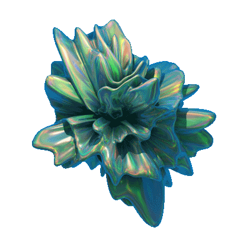
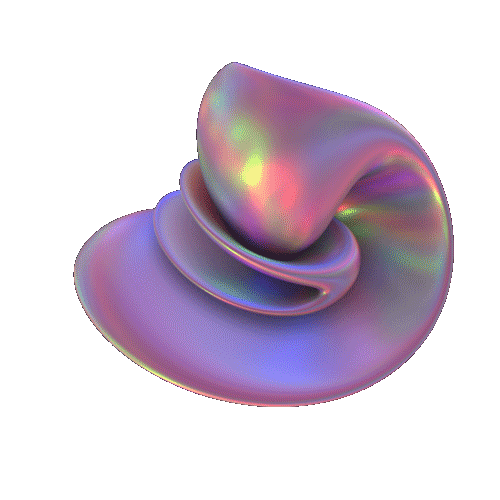

<h1 align="center">3D Reconstruction from 2D Images</h1>

  
  
  
  

Ferramenta do meu TCC que transforma uma foto comum em um modelo 3D. Ela tira o fundo da imagem, estima a profundidade de cada pixel com inteligência artificial e monta a malha 3D a partir disso, pronta para abrir no Blender.

> [!NOTE]
> O código fica num repositório privado. Este repositório é a vitrine do projeto.

## Destaques

- **Uma foto basta:** o modelo 3D sai de uma única imagem, sem precisar fotografar o objeto de vários ângulos.
- **Profundidade por IA:** o MiDaS, rede neural treinada para estimar distância, diz o quanto cada pixel está perto ou longe.
- **Fundo removido sozinho:** o objeto principal é separado do resto antes de virar 3D.
- **Saída em `.obj`:** formato aberto que o Blender e outros programas de modelagem leem direto.
- **Interface simples:** uma janela para escolher a imagem e gerar o modelo, com o andamento de cada etapa na tela.

## Como foi feito

O projeto começou pelo básico, gerando formas simples em 3D, e foi ganhando etapas até chegar ao caminho completo da foto ao modelo.

<b>O caminho da foto ao modelo 3D</b>

- **Preparo da imagem:** a foto é reduzida para 256 x 256 pixels e normalizada.
- **Remoção do fundo:** a biblioteca rembg separa o objeto principal e deixa o fundo transparente.
- **Mapa de profundidade:** o MiDaS (versão `MiDaS_small`, carregada pelo PyTorch Hub) recebe a imagem em 384 x 384 e devolve um valor de profundidade para cada pixel.
- **Malha 3D:** cada pixel do mapa vira um vértice, com a profundidade como altura, e cada quadrado de quatro vértices vira dois triângulos. O resultado é gravado em `.obj`.
- **Visualização:** a malha é desenhada em 3D com o Matplotlib.
- **Interface:** feita em Tkinter, com botão para carregar a imagem, botão para gerar, tela de carregamento por cima e o processamento numa thread separada para a janela não travar.

<b>Visão computacional</b>

- **Primeiros passos com o OpenCV:** carregar, exibir, redimensionar, passar para escala de cinza e aplicar filtros.
- **Detecção de contornos:** limiarização da imagem em preto e branco e busca dos contornos, desenhados por cima da foto original.
- **Remoção de fundo sem IA:** bordas pelo detector de Canny, escolha do maior contorno e uma máscara binária (objeto em branco, fundo em preto) aplicada sobre a imagem.
- **Formas básicas em 3D:** cubo, esfera, cilindro, pirâmide, plano e objetos montados a partir delas, como um pirulito e um garfo, gerados com o Trimesh e exportados em `.obj` para conferir no Blender.
- **Nuvem de pontos:** o mapa de profundidade, gerado também com o MiDaS `DPT_Large`, vira uma nuvem de pontos no Open3D, salva em `.ply`.

<b>Modelo de inteligência artificial</b>

- **Primeiro contato com treino:** uma rede convolucional em TensorFlow treinada para reconhecer dígitos escritos à mão (MNIST), para entender o ciclo de montar, treinar e salvar um modelo.
- **Da imagem para o volume:** um autoencoder em PyTorch que recebe uma imagem de 64 x 64 pixels, comprime em 1024 valores e expande de volta, com convoluções 3D, até uma grade de voxels (pequenos cubos que ocupam ou não cada posição do espaço).
- **Treino:** erro quadrático médio entre a grade gerada e a esperada, com o otimizador Adam.

<b>Que tipo de imagem funciona melhor</b>

Uma única imagem não carrega toda a informação de profundidade e forma do objeto, então a foto de entrada pesa tanto quanto o modelo.

- **Funciona melhor:** um objeto só, visto de frente, com fundo branco, de uma cor só ou já removido.
- **Atrapalha:** texto na imagem, vários objetos juntos e fundo cheio de detalhes.

## Tecnologias

- **Linguagem:** Python.
- **Inteligência artificial:** PyTorch e torchvision com o MiDaS, e TensorFlow nos primeiros testes.
- **Imagem:** OpenCV, Pillow e rembg.
- **3D:** Trimesh, Open3D e Matplotlib, com o Blender para conferir os modelos.
- **Interface:** Tkinter.

---

Licença [MIT](LICENSE) · Feito por [Gustavo Victor](https://github.com/guavovic)
